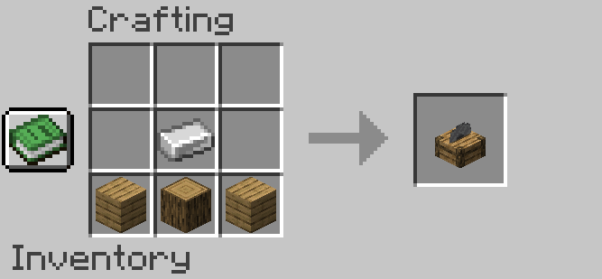

# The Woodcutter Mod for Minecraft (Fabric)

**Supported Minecraft Versions:** `26.1` | `26.1.1` | `26.1.2` | `26.2` | `26.3`

**Fabric version:** `0.19.5+`

A Minecraft Fabric mod that adds a **Woodcutter** block — a wooden equivalent of the Stonecutter!

## Features
- Quickly craft stairs, slabs, fences, gates, pressure plates, buttons, trapdoors, and doors from any wood type.
- Supports all 13 wood types: Oak, Spruce, Birch, Jungle, Acacia, Dark Oak, Mangrove, Cherry, Pale Oak, Poplar, Crimson, Warped, and Bamboo.
- Balanced recipes with custom sound effects and 3D animated block model.
- Fully compatible with Minecraft 26.1-26.3!

## Crafting Recipe

### Mod Compatibility
- **EMI:** Fully supported! Adds a dedicated **"Woodcutting"** recipe tab with compact UI.

To build this project from source, download the EMI jar for Minecraft 26.3 and place it in the /libs folder.